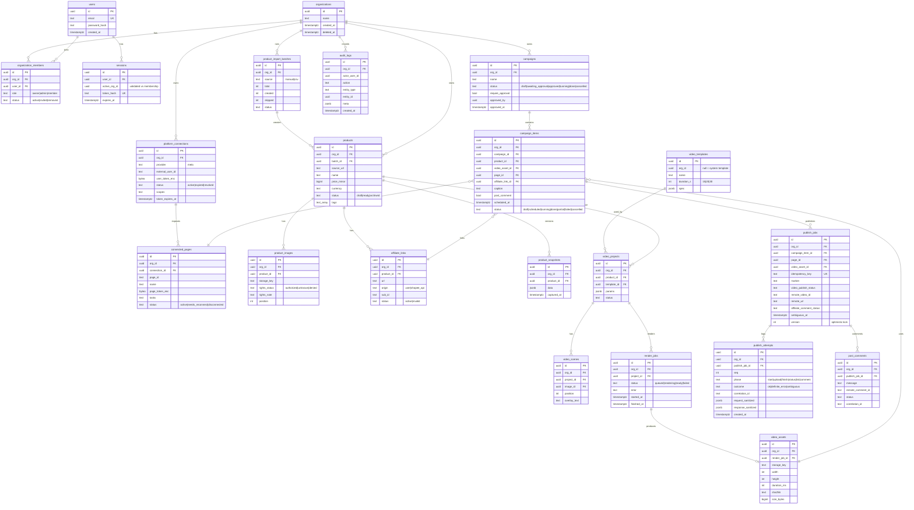

# ERD — Phase 0 proposal (MVP entities)

Status: PROPOSED. Types are illustrative (PostgreSQL). Billing tables (`subscriptions`, `plans`, `payments`, `invoices`, `usage_events`) are **Phase 6** and omitted.

## Conventions
- Every tenant table has `org_id uuid NOT NULL` and `UNIQUE (org_id, id)`. Child tables reference parents with composite FKs `(org_id, parent_id) → parent(org_id, id)`, so a cross-tenant reference is impossible at DB level (ADR-0002).
- `users`, `organizations`, `plans` are global; everything else is tenant-owned.
- Timestamps are `timestamptz` UTC. Provider tokens are stored encrypted (`*_enc`), never in logs.

## Constraints and indexes
| Table | Constraint / index | Purpose |
|---|---|---|
| all tenant tables | `NOT NULL org_id`, `UNIQUE (org_id, id)`, index `(org_id, created_at)` | isolation, listing |
| all child tables | composite FK `(org_id, parent_id)` → parent `(org_id, id)` | no cross-tenant link |
| organization_members | `UNIQUE (org_id, user_id)`; exactly one `owner` enforced in service + partial unique index | membership |
| platform_connections | `UNIQUE (org_id, provider, external_user_id)` | no duplicate connect |
| connected_pages | `UNIQUE (org_id, page_id)` | one row per Page per org |
| products | `UNIQUE (org_id, source_url)` (nullable URL → partial index where not null); optional `(org_id, lower(name))` non-unique | dedup on import |
| affiliate_links | partial `UNIQUE (org_id, product_id) WHERE status='active'` | one active link per product (MVP) |
| product_images | `UNIQUE (org_id, product_id, position)` | order |
| render_jobs | index `(org_id, status)` | worker pickup |
| campaign_items | `UNIQUE (org_id, campaign_id, product_id, page_id)`; index `(org_id, status, scheduled_at)` | no duplicate item, scheduler scan |
| publish_jobs | **`UNIQUE (idempotency_key)`**, `idempotency_key = sha256(org_id, campaign_item_id, page_id, video_asset_id)`; index `(org_id, video_publish_status)`; partial index where status = `unknown` | dedup, reconcile queue |
| publish_attempts | `UNIQUE (publish_job_id, seq)`; append-only (no UPDATE/DELETE grants) | immutable log |
| post_comments | `UNIQUE (publish_job_id, remote_comment_id)` where not null | no double record |
| audit_logs | index `(org_id, created_at)`; append-only | audit |

## Lifecycle state columns
- `render_jobs.status`, `campaigns.status`, `campaign_items.status`: see PRD §5.
- `publish_jobs.video_publish_status`: queued → starting → uploading → finishing → processing → published | failed; any ambiguous step → unknown → (reconcile only) → processing/published/failed/failed_safe_to_retry; failed_safe_to_retry → queued (new attempts, same job row, `remote_video_id` cleared; old id preserved in attempts).
- `publish_jobs.affiliate_comment_status`: not_requested | pending | posting | posted | failed | unknown | skipped (independent).
- Transitions are validated in the domain layer and guarded by `version` (optimistic lock).

## Phase 6 (not modeled)
subscriptions, plans, payments, invoices, usage_events.
