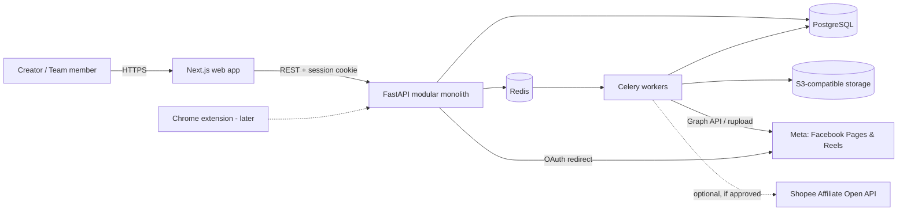
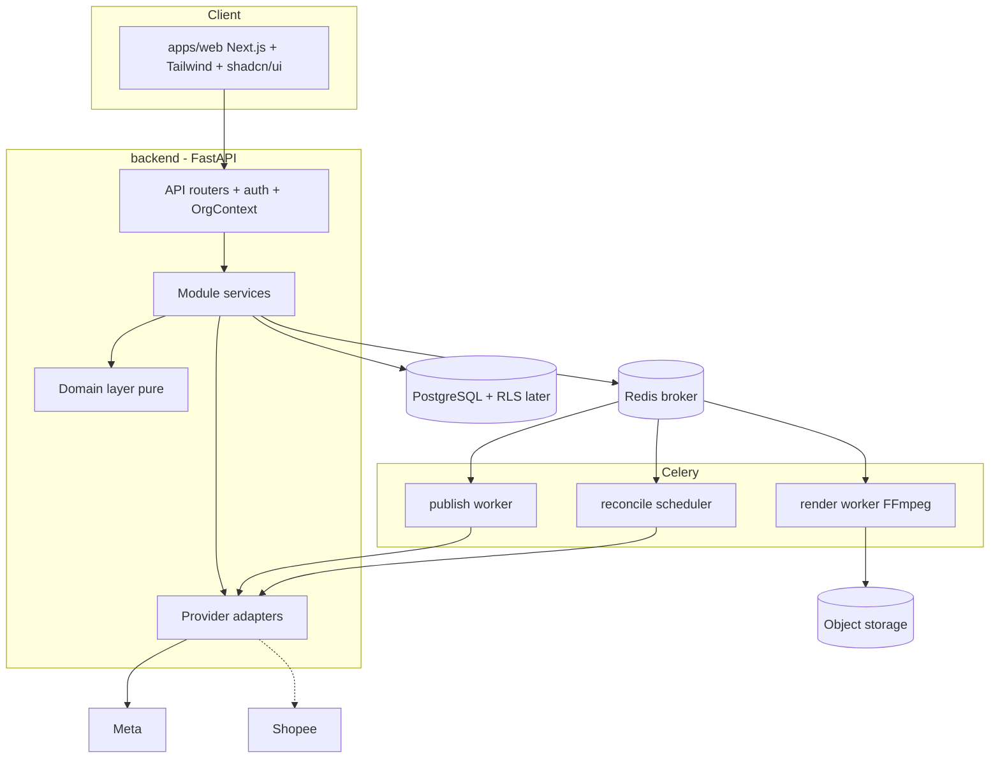
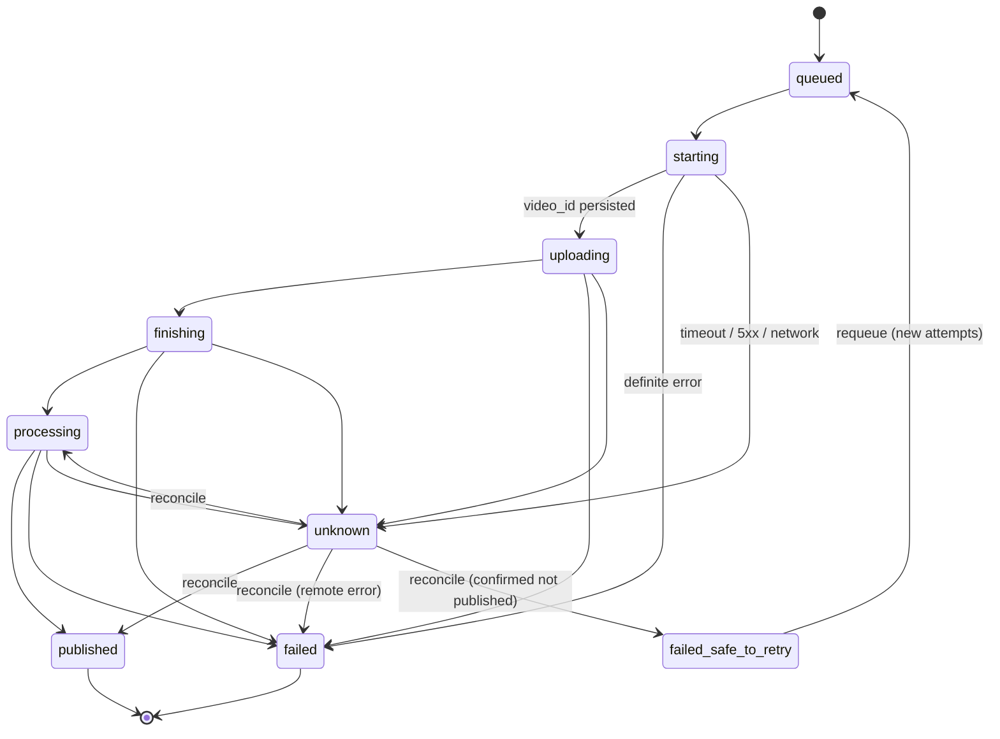
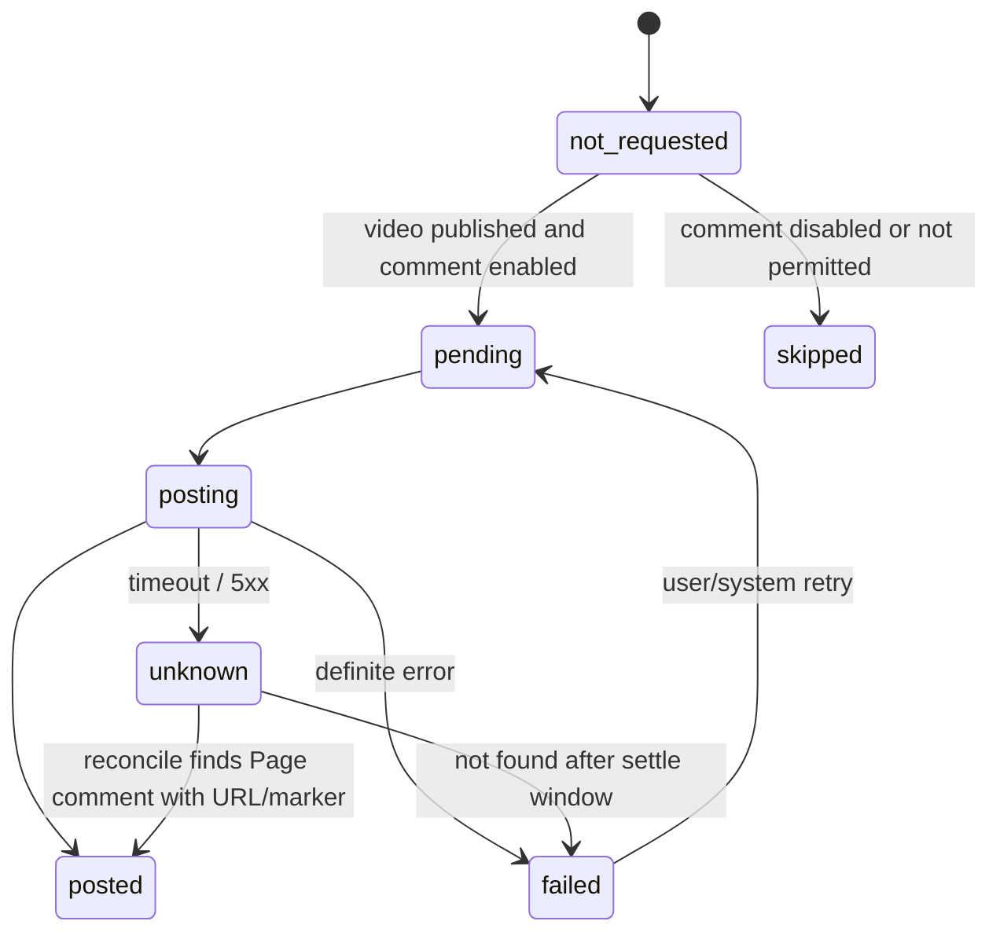

# Architecture — Phase 0 proposal

Status: PROPOSED (decisions in `../decisions/`). Provider behavior is DOCUMENTED-only; see `../api/API_FEASIBILITY.md`.

## 1. Modular monolith modules
Single FastAPI codebase, one PostgreSQL, Celery workers on Redis. Modules talk through service interfaces; no module reads another's tables directly except via its service.

| Module | Responsibility | Owns tables |
|---|---|---|
| identity_tenancy | Users, sessions, orgs, membership, roles, `OrgContext` resolution | users, organizations, organization_members, sessions |
| catalog | Products, images + rights, import batches, snapshots | products, product_images, product_import_batches, product_snapshots |
| affiliate | Affiliate links, origin, sub-ids; Shopee adapter use (optional) | affiliate_links |
| media_render | Templates, projects, FFmpeg render jobs, storage | video_templates, video_projects, video_scenes, render_jobs, video_assets |
| campaigns | Campaigns, items, approvals, scheduling, Page cap planning | campaigns, campaign_items |
| publishing | Publish job state machine, reconcile, comments | publish_jobs, publish_attempts, post_comments |
| provider_adapters | `MetaReelsPort`, `ShopeeAffiliatePort`, mocks; no business rules | platform_connections, connected_pages (token storage via identity/crypto service) |
| audit | Append-only audit and structured events | audit_logs |

Pure domain logic (state machines, key derivation, reconcile decisions) lives in each module's `domain/` with no I/O; adapters in `adapters/`. Prototype: `spikes/phase0_publish`.

Current backend layout (`backend/app/`): `core` (config, db, models, auth), `catalog` (products, Shopee offers and links), `content` (storyboards, renders, previews), `publishing` (Meta, campaigns, worker) and `insights` (Google Trends, Affiliate reports); `main.py` and `operations.py` stay at the root. Run the worker with `python -m app.publishing.campaign_worker`. The per-module `domain/` split above is still a target and will move over one module at a time.

## 2. Context diagram

## 3. Container diagram

## 4. Tenant isolation (ADR-0002)
- Every tenant table has non-null `org_id`; composite FKs `(org_id, id)` forbid cross-tenant references.
- The org is resolved server-side from the authenticated session's membership; a client-supplied org id (path or header) is only a selector and must match an active membership, otherwise 404.
- All repositories take an `OrgContext` (org_id, user_id, role) and add `org_id` to every query; no unscoped repository methods are exposed to routers. Workers receive `org_id` in the task payload and rebuild an `OrgContext` (system actor).
- Cross-tenant access returns 404, not 403 (no existence leak).
- Object storage keys are prefixed `org/{org_id}/`; media served via short-lived signed URLs.
- Postgres RLS (`SET LOCAL app.org_id`) is defense in depth, evaluated in Phase 1 (ADR status Proposed).
- Tests: two-org fixture; every list/get/update/delete endpoint has a cross-tenant 404 test.

## 5. Job state machines

### video_publish_status

Rules
- `unknown` leaves only through reconcile. Run/retry/requeue of `unknown` is rejected.
- Persist remote `video_id` immediately after `start` returns, before uploading.
- Each external call writes one immutable `publish_attempts` row (sanitized request/response, correlation id).
- idempotency_key = sha256(org_id, campaign_item_id, page_id, video_asset_id), unique; a repeated submit returns the existing job.

### affiliate_comment_status (independent)

The comment starts only after the video is `published`. Comment failure never changes video status.

## 6. Reconciliation
Triggered by a periodic scheduler and by "Check status".
1. Video id known → `GET /{video-id}?fields=status`: published → published; processing → processing; error → failed (or failed_safe_to_retry if confirmed unpublished); uploading/ready (not published) → stay `unknown` inside the settle window, then `failed_safe_to_retry`.
2. Video id unknown (start ambiguous or state lost) → `GET /{page-id}/video_reels?since=…`, match the idempotency marker in `description` (short token appended at `finish`). Found → adopt id; none after window → `failed_safe_to_retry`.
   Caveat (found in spike): the description is only sent at `finish`, so a start-phase orphan session has no marker and cannot be listed — but it is also unpublished and harmless. Whether Meta lists unpublished/processing reels is UNVERIFIED.
3. Comment unknown → read comments of the post authored by the Page that contain the affiliate URL/marker → posted; none after window → failed.
4. Reconcile reads are safe to repeat; reconcile failure leaves the job `unknown`.
5. Enforce Meta's documented 30 API-published Reels / 24 h per Page in the scheduler.

## 7. Threat model (STRIDE-light)
| Threat | Example | Mitigation |
|---|---|---|
| Spoofing | Stolen session, forged org selector | HttpOnly+SameSite cookies, short sessions, membership check per request |
| Tampering | Edit another tenant's product; alter attempt log | Org-scoped queries, composite FKs, RLS later; append-only attempts/audit |
| Repudiation | "I didn't approve that post" | Audit log with actor, approval records, correlation ids |
| Information disclosure | Cross-tenant read; token in logs; media URL guessing | 404 on cross-tenant, tokens encrypted (envelope key from env/KMS), log redaction + tests, signed URLs, no secrets in fixtures |
| Denial of service | Huge CSV/video uploads; queue flood; Page rate cap | Size limits, per-org rate limits, per-Page 30/24 h cap, Celery routing and concurrency limits |
| Elevation of privilege | Member publishes without approval | Role checks in service layer, server-side approval state |
| Provider abuse | Mass spam comments → Page/app restriction | Per-Page caps, comment templates, disclosure, human approval default |
| Supply chain / SSRF | Fetching user-supplied image URLs | Allowlist/scan, block private IPs, size and type checks |

## 8. Initial REST contract (MVP, `/api/v1`)
Auth: session cookie. `org` is taken from the session's active workspace; endpoints under `/orgs/{org_id}` require active membership (else 404). Roles: O=owner, A=admin, M=member.

| Method + path | Purpose | Roles |
|---|---|---|
| POST `/auth/register`, `/auth/login`, `/auth/logout` | Account/session | public/any |
| GET `/me` | User + memberships | any |
| POST `/orgs` | Create workspace | any |
| GET/POST `/orgs/{org}/members`, PATCH/DELETE `/orgs/{org}/members/{id}` | Manage members | O,A |
| GET/POST `/orgs/{org}/products`; GET/PATCH/DELETE `/…/products/{id}` | Product CRUD | read: all; write: M+ |
| POST `/orgs/{org}/products/import` (CSV), GET `/…/import-batches/{id}` | CSV import | M+ |
| PUT `/orgs/{org}/products/{id}/affiliate-link` | Save affiliate URL | M+ |
| POST `/orgs/{org}/products/{id}/images` | Add image + rights flag | M+ |
| GET `/orgs/{org}/video-templates` | Templates | all |
| POST `/orgs/{org}/video-projects`, POST `/…/video-projects/{id}/render` | Create/render | M+ |
| GET `/orgs/{org}/render-jobs/{id}`, GET `/…/video-assets/{id}` (signed URL) | Status/download | all |
| GET `/orgs/{org}/connections/meta/authorize` → redirect; GET `/connections/meta/callback` | OAuth | O,A |
| GET `/orgs/{org}/pages`; DELETE `/orgs/{org}/pages/{id}` (disconnect) | Pages | read: all; delete: O,A |
| GET/POST `/orgs/{org}/campaigns`; GET/PATCH `/…/campaigns/{id}` | Campaign | M+ (create), O,A (approve) |
| POST `/orgs/{org}/campaigns/{id}/submit`, `/approve`, `/cancel` | Workflow | M+ / O,A / O,A |
| GET `/orgs/{org}/jobs`, GET `/…/jobs/{id}` (attempts) | Job monitor | all |
| POST `/orgs/{org}/jobs/{id}/reconcile` | Check status | O,A |
| POST `/orgs/{org}/jobs/{id}/retry` | Only from failed_safe_to_retry; 409 if unknown | O,A |
| POST `/orgs/{org}/jobs/{id}/comment/retry` | Retry comment (failed only; 409 if unknown) | O,A |
| GET `/orgs/{org}/audit-logs` | Audit | O,A |
| GET `/healthz` | Liveness | public |

Conventions: `Idempotency-Key` header on POST create endpoints; `X-Correlation-Id` echoed and logged; errors as `{code, message, action}` with actionable text.
