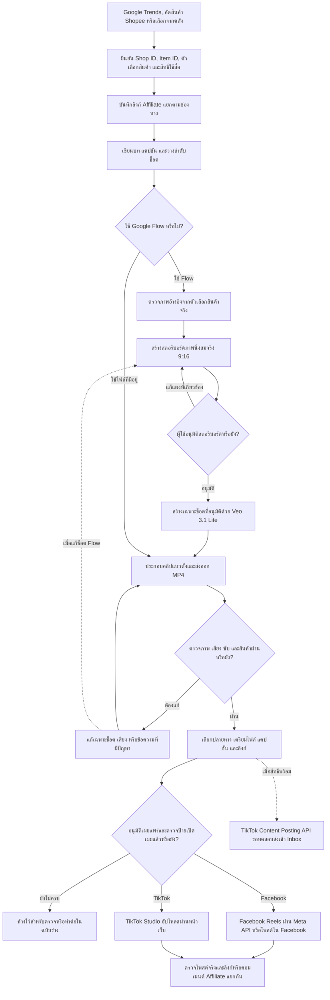
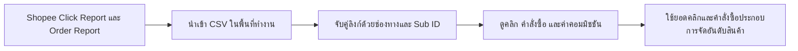

# Affiliate Studio workflow

## จากเลือกสินค้าถึงตรวจโพสต์

- **Google Flow** ใช้ตัวละครพิธีกรคัดของเข้าบ้านและเสียง Callirrhoe ตามกฎโครงการ หากแก้หรือเพิ่มช็อต ให้แสดงแผงสตอรีบอร์ดที่เกี่ยวข้องและขออนุมัติอีกครั้งก่อนสร้างวิดีโอ เก็บภาพอ้างอิง คลิป เสียง และเวอร์ชันที่อนุมัติตามเลขช็อต [กฎการผลิตและเผยแพร่](../../AGENTS.md)
- **Facebook** เคยยืนยันการเผยแพร่ Reel และอ่านคอมเมนต์ Affiliate กลับผ่าน Meta API แล้ว ส่วนการปักสินค้าผ่านหน้า Facebook ใช้ขั้นตอนแยกและยังรอยืนยันผล [วิธีเชื่อม Facebook](../../README.md#connect-a-local-facebook-page)
- **TikTok** เคยอัปโหลด MP4 ทดสอบผ่าน TikTok Studio จนเห็นสถานะ Uploaded และตัวอย่างวิดีโอ การส่งฉบับร่างผ่าน API ยังรอการตั้งค่า Sandbox และการอนุญาต `video.upload` [สถานะการทดสอบ](../agent/SESSION_HANDOFF.md)

## รายงาน Affiliate และการเลือกสินค้ารอบถัดไป

ดูวิธีนำเข้าและวิธีนับคลิกกับคำสั่งซื้อจาก [คู่มือรายงาน Affiliate](../../README.md#import-shopee-affiliate-reports)
